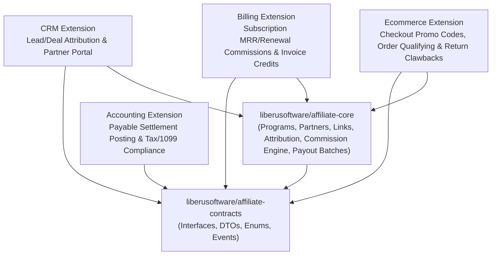

# Affiliate management and referral contracts architecture

This specification defines the canonical Liberu architecture for **Affiliate Management and Customer Referrals**, establishing a shared contract boundary (`liberusoftware/affiliate-contracts`) and reusable core capability (`liberusoftware/affiliate-core` / `affiliates`) that any product repository (CRM, Billing, Ecommerce, Accounting, SaaS workspaces) can extend without coupling to a single product's order, invoice, or lead schema.

**Foundation & shared modules:**
- [`affiliate-contracts`](../projects/boilerplate/features/affiliate-contracts.md) (`liberusoftware/affiliate-contracts`) — provider- and product-neutral PHP interfaces, immutable DTOs, attribution envelopes, commission rule contracts, and domain events.
- [`affiliates`](../projects/boilerplate/features/affiliates.md) (`liberusoftware/affiliate-core`) — reusable affiliate program lifecycle, partner enrollment, referral links/codes, click/touch attribution, tiered commission calculation, clawback/hold windows, fraud/self-referral policy, and payout settlement batching.

**Product-specific extensions:**
- **CRM:** [Affiliate Management](../projects/crm/features/affiliate-management.md) · [Referrals](../projects/crm/features/referrals.md)
- **Billing:** [Referrals](../projects/billing/features/referrals.md) · [BILLING.md](../projects/billing/BILLING.md)
- **Ecommerce:** [Referrals](../projects/ecommerce/features/referrals.md) · [Commissions and Settlements](../projects/ecommerce/features/commissions-and-settlements.md)

## 1. Architectural separation: contracts, core capability, and product extensions

1. **Zero schema coupling across products:** `liberusoftware/affiliate-contracts` contains only interfaces, value objects (`ReferralCode`, `AttributionToken`, `CommissionRate`, `ConversionSubjectReference`, `MoneyAmount`), enums, and event contracts. It declares no Eloquent models, migrations, or product dependencies.
2. **Product repositories implement conversion & settlement bridges:** An Ecommerce repository translates an authoritative `OrderPaid` or `OrderRefunded` event into `ConversionRecorderContract::recordConversion()` / `reverseConversion()`. A Billing repository translates `InvoicePaid`, `SubscriptionRenewed`, or `ChargebackOpened` into the same contract. A CRM repository links `LeadQualified` or `DealWon` to multi-touch or last-touch referral attribution.
3. **Authoritative financial boundaries:** Commission accrual and hold periods belong to the affiliate engine, while actual disbursement (bank transfer, Stripe Connect payout, PayPal payout, store credit, or invoice credit) is executed by the owning payment or accounting module through `PayoutSettlementContract`.

## 2. Public contracts (`liberusoftware/affiliate-contracts`)

Every repository that participates in referrals or affiliate management binds or consumes these interfaces:

| Contract | Purpose | Core method signatures |
| --- | --- | --- |
| `AffiliateProgramContract` | Resolves program terms, attribution window (days), model (`first_touch`, `last_touch`, `coupon_override`), hold/maturity period, recurring-commission cap, and eligibility policy | `resolveProgram(TenantContext $tenant, string $programKey): AffiliateProgramDto` |
| `AffiliatePartnerEnrollmentContract` | Manages partner/advocate applications, KYC/tax readiness status, approval workflow, tier assignment, and custom commission overrides | `apply(EnrollAffiliateCommand $command): AffiliatePartnerDto` `approve(string $partnerId, Authenticatable $reviewer): AffiliatePartnerDto` |
| `ReferralAttributionContract` | Issues signed referral links/codes, records first-party click/touch tokens, and resolves the winning advocate/affiliate for a conversion subject | `recordTouch(RecordReferralTouchCommand $command): AttributionTouchDto` `resolveAttribution(ConversionSubjectReference $subject, ?string $promoCode = null): ?ResolvedAttributionDto` |
| `FraudAndSelfReferralPolicyContract` | Evaluates self-referral, same-household/company/payment-fingerprint collisions, velocity anomalies, disallowed traffic sources, and duplicate prospect rules before qualifying a conversion | `evaluate(ResolvedAttributionDto $attribution, ConversionContextDto $context): FraudEvaluationResultDto` |
| `ConversionRecorderContract` | Records idempotent qualified conversions from orders, invoices, subscriptions, or deals, and processes partial/full clawbacks on refunds, cancellations, or chargebacks | `recordConversion(RecordAffiliateConversionCommand $command): AffiliateConversionDto` `reverseConversion(ReverseAffiliateConversionCommand $command): AffiliateConversionDto` |
| `CommissionCalculatorContract` | Calculates flat, percentage, tiered-volume, product-category, or recurring-installment commissions using exact minor-unit currency arithmetic and snapshotted exchange rates | `calculate(AffiliateProgramDto $program, AffiliatePartnerDto $partner, ConversionContextDto $context): CalculatedCommissionDto` |
| `PayoutSettlementContract` | Locks matured commissions after the clawback hold window, enforces minimum payout thresholds and tax/compliance holds, creates approved payout batches, and hands off disbursement to Payment Core or Accounting | `createSettlementBatch(CreatePayoutBatchCommand $command): PayoutBatchDto` `markSettled(string $batchId, string $settlementReference): PayoutBatchDto` |
| `RewardFulfillmentContract` | Issues two-sided customer referral rewards (advocate reward + friend discount/credit/entitlement) when a customer referral qualifies | `fulfillReferralReward(QualifiedReferralDto $referral): RewardFulfillmentResultDto` |

## 3. Domain invariants and lifecycle rules

- **Server-authoritative conversion values:** Client browsers and mobile apps may submit a referral token (`ref`) or coupon code, but commissionable revenue, net of tax/shipping/discounts, is always read from the authoritative server record (order, invoice, subscription, or contract).
- **Idempotent conversion and clawback ledger:** Every conversion and reversal is keyed by `(tenant_id, source_type, source_id, conversion_event_key)`. Commission adjustments create immutable ledger entries (`pending`, `held`, `matured`, `approved`, `paid`, `clawed_back`, `voided`) rather than mutating historical paid balances in place.
- **Clawback and hold windows:** Commissions remain in `held` state until the program's refund/dispute maturity window elapses. If a source order or invoice is refunded or disputed before payout, the commission is reduced or voided automatically; if already paid, a negative carry-forward debit is recorded against the partner's next settlement batch.
- **Self-referral and abuse prevention:** `FraudAndSelfReferralPolicyContract` blocks conversions where the advocate and buyer share an account, organization, verified email domain (when restricted), payment instrument fingerprint, or recent attribution velocity threshold, flagging borderline cases for operator review.
- **Privacy and consent:** Referral click tracking uses first-party pseudonymous attribution tokens and respects foundation consent categories ([BOILERPLATE.md](../projects/boilerplate/BOILERPLATE.md#124-consent-privacy-and-security-controls)). Advocate portals never expose referred customers' private personal data, full email addresses, or payment details.

## 4. Extending affiliate contracts in consuming repositories

1. **Require `liberusoftware/affiliate-contracts`** in the product module's `composer.json` (and optionally `liberusoftware/affiliate-core` in the host application).
2. **Implement a domain listener or bridge** in the product repository that listens to authoritative post-commit events (e.g., `OrderCaptured`, `InvoicePaid`, `SubscriptionRenewed`, `PaymentRefunded`, `PaymentDisputed`) and invokes `ConversionRecorderContract`.
3. **Register custom commission or reward rules** by binding product-specific implementations of `CommissionCalculatorContract`, `FraudAndSelfReferralPolicyContract`, or `RewardFulfillmentContract` into the container.
4. **Expose presentation adapters** across Filament 5, Livewire 4, React/Inertia, Vue/Inertia, Next.js, Nuxt 4, React Native, and Flutter/Dart using the matching one-to-one module specifications.
