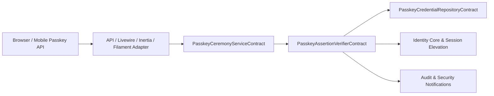

# Passkeys and WebAuthn architecture

This specification defines the canonical Liberu architecture for **Passkeys and WebAuthn / FIDO2 authentication**. Passkeys provide phishing-resistant passwordless sign-in, discoverable credentials (resident keys), platform and roaming hardware security-key support, and cryptographic step-up authentication across every Liberu product.

**Foundation module:** [`passkeys`](../projects/boilerplate/features/passkeys.md) ([core](../projects/boilerplate/core/passkeys.md) · [API](../projects/boilerplate/api/passkeys.md) · [Next.js](../projects/boilerplate/nextjs/passkeys.md))
**Intended package identity:** `liberusoftware/passkeys`
**Related foundation boundaries:** [Identity Core](../projects/boilerplate/features/identity-core.md) · [Two-Factor Authentication](../projects/boilerplate/features/two-factor-authentication.md) · [Sessions and Devices](../projects/boilerplate/features/sessions-devices.md) · [BOILERPLATE.md](../projects/boilerplate/BOILERPLATE.md)

## 1. Architectural boundary and ownership

The `passkeys` foundation module owns WebAuthn Relying Party (RP) ceremony generation, challenge storage, attestation and assertion verification, credential public-key persistence, signature-counter progression, clone detection, authenticator naming and revocation, and step-up verification tokens.

- **Presentation-neutral domain core (`liberusoftware/passkeys`):** Owns ceremony options DTOs, challenge lifecycle, cryptographic verification, credential repository, policies, and audit events.
- **No direct product coupling:** Product modules never verify WebAuthn CBOR/COSE payloads or query credential tables directly; they consume authenticated session state, recent-authentication elevation checks, or the public contracts below.
- **Coexistence with Identity and Two-Factor Authentication:** Passkeys can satisfy primary passwordless authentication (when `userVerification = required` and policy permits) or act as a second-factor / step-up authenticator alongside [Two-Factor Authentication](../projects/boilerplate/features/two-factor-authentication.md).

## 2. Public contracts and extension points

Consuming applications and authentication bridges interact with the passkey module exclusively through versioned contracts:

| Contract | Responsibility | Key methods and DTOs |
| --- | --- | --- |
| `PasskeyRelyingPartyConfigContract` | Resolves exact Relying Party ID (`rp.id`), display name, allowed origins, timeout, attestation conveyance, and user-verification policy per tenant/domain | `resolve(TenantContext $context): RelyingPartyConfiguration` |
| `PasskeyCeremonyServiceContract` | Issues cryptographically random single-use registration (`PublicKeyCredentialCreationOptions`) and assertion (`PublicKeyCredentialRequestOptions`) challenges bound to session and actor/intent | `beginRegistration(Authenticatable $actor, PasskeyEnrollmentIntent $intent): PublicKeyCredentialCreationOptionsDto` `beginAssertion(?Authenticatable $actor, PasskeyAuthIntent $intent): PublicKeyCredentialRequestOptionsDto` |
| `PasskeyRegistrarContract` | Validates registration attestation response, origin, RP ID hash, challenge expiry, COSE algorithm support, and credential uniqueness before persisting the public key | `completeRegistration(Authenticatable $actor, PasskeyAttestationPayload $payload): RegisteredPasskeyDto` |
| `PasskeyAssertionVerifierContract` | Verifies authenticator data, client data JSON, challenge binding, user presence (`UP`), user verification (`UV`), and signature counter progression; emits clone alerts on counter regression | `verifyAssertion(PasskeyAssertionPayload $payload, PasskeyAuthIntent $intent): VerifiedPasskeyAssertionDto` |
| `PasskeyCredentialRepositoryContract` | Stores, lists, renames, suspends, and revokes passkey credentials scoped to actor and tenant policy | `forActor(Authenticatable $actor): Collection` `revoke(Authenticatable $actor, string $credentialId, string $reason): void` |
| `StepUpAuthenticationContract` | Evaluates or records recent cryptographic step-up verification for high-risk actions (payout approval, refund override, ownership transfer, API key creation, security changes) | `hasRecentStepUp(Authenticatable $actor, string $scope, int $maxAgeSeconds = 300): bool` |

## 3. Ceremony and security invariants

1. **Challenge entropy and single-use binding:** Every registration or authentication ceremony generates a minimum 32-byte cryptographically random challenge with a strict TTL (default 120–300 seconds), bound in server state to the ceremony type (`registration`, `login`, `step_up`), expected origin/RP ID, and session/correlation identifier. Challenges are consumed atomically on first verification attempt.
2. **Strict Relying Party and origin validation:** Verification rejects any response whose `clientDataJSON.origin` or `authData.rpIdHash` does not match the allowlisted Relying Party origin and RP ID for the active tenant/application host. Wildcard origin acceptance is prohibited.
3. **Discoverable credentials (resident keys) and non-enumeration:** Passwordless sign-in supports discoverable credentials (`residentKey = required` or `preferred`) via conditional UI (autofill) and explicit modal flows. Account-targeted assertion requests must not leak whether an email/identifier has enrolled passkeys.
4. **Enrollment requires recent authentication:** Enrolling a new passkey, renaming or deleting an existing passkey, or changing recovery settings requires an authenticated session with recent password, existing passkey, or 2FA step-up verification.
5. **Signature counter and clone detection:** When an authenticator reports a non-zero signature counter, the verifier checks strictly increasing progression (`incoming > stored`). A regressed or duplicate counter marks the credential as suspected-cloned, rejects the assertion, revokes or quarantines affected sessions, records a high-severity audit event, and notifies the user/security administrators.
6. **Backup eligibility and sync metadata:** Record authenticator flags (`BE` backup eligible, `BS` backup state, `UV` user verified), AAGUID/authenticator metadata where policy permits, and transport hints (`internal`, `hybrid`, `usb`, `nfc`, `ble`) without treating synced passkeys as hardware-bound keys when enterprise policy requires hardware attestation.
7. **Safe recovery and lockout prevention:** Users cannot revoke their last primary authentication factor unless an alternative verified factor (password + TOTP, secondary passkey, or administrator-approved recovery path) remains active according to tenant security policy.

## 4. Cross-technology delivery requirements

- **Laravel HTTP API (`-api`):** Publishes `/api/v1/passkeys/register/options`, `/api/v1/passkeys/register`, `/api/v1/passkeys/authenticate/options`, `/api/v1/passkeys/authenticate`, `/api/v1/passkeys/step-up`, and `/api/v1/passkeys/{credential}` (`PATCH` rename, `DELETE` revoke) using base64url-encoded binary fields and RFC 9457 Problem Details.
- **Filament 5 & Livewire 4:** Provides security-settings passkey management tables, enrollment modals invoking `navigator.credentials.create()`, login/step-up components invoking `navigator.credentials.get()`, and administrator credential-quarantine/recovery actions.
- **React/Inertia, Vue/Inertia, Next.js & Nuxt 4:** Share typed base64url ArrayBuffer WebAuthn helpers and conditional-mediation (`mediation: 'conditional'`) autofill hooks while keeping session/CSRF or BFF transport in each framework's adapter.
- **React Native (Expo) & Flutter / Dart (Mobile & Desktop):** Integrate native platform passkey credential managers (`ASAuthorizationPlatformPublicKeyCredentialProvider` / `ASAuthorizationSecurityKeyPublicKeyCredentialProvider` on iOS/macOS, `CredentialManager` on Android, Windows Hello / FIDO2 platform APIs on desktop) bound to associated domain / Digital Asset Links (`/.well-known/apple-app-site-association` and `/.well-known/assetlinks.json`).
