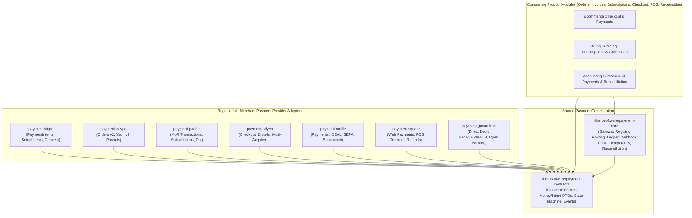

# Unified contract-based merchant payment architecture

This specification defines the canonical Liberu architecture for **Merchant Payment Services**. Every payment gateway—such as **Stripe**, **PayPal**, **Paddle**, **Adyen**, **Mollie**, **Square**, and **GoCardless**—is implemented as an isolated provider adapter that extends `liberusoftware/payment-contracts` and registers with `liberusoftware/payment-core`.

Domain modules in Billing, Ecommerce, Accounting, CRM, and vertical products never call merchant SDKs (`stripe/stripe-php`, PayPal REST, Paddle, Adyen, etc.) directly or embed gateway-specific columns in product tables.

**Canonical package hierarchy (single shared implementation — never duplicated per product):**
- **Contracts (`liberusoftware/payment-contracts`):** [Boilerplate specification](../projects/boilerplate/features/payment-contracts.md)
- **Capability Core (`liberusoftware/payment-core`):** [Boilerplate specification](../projects/boilerplate/features/payment-core.md)
- **Product Consumers (consume `payment-contracts` + `payment-core`, never duplicate gateways):** [Billing Payments](../projects/billing/features/payments.md) · [Ecommerce Payments](../projects/ecommerce/features/payments.md) · [Ecommerce Payment Operations](../projects/ecommerce/features/payment-operations.md) · [Accounting Customer Payments](../projects/accounting/features/customer-payments.md)
- **Merchant Provider Adapters (one shared module per payment method, all extending `liberusoftware/payment-contracts`):**
  - **Stripe (`liberusoftware/payment-stripe`):** [Specification](../projects/boilerplate/features/payment-stripe.md) (consolidates [`module-billing-stripe`](../projects/billing/features/module-billing-stripe.md))
  - **PayPal (`liberusoftware/payment-paypal`):** [Specification](../projects/boilerplate/features/payment-paypal.md)
  - **Paddle (`liberusoftware/payment-paddle`):** [Specification](../projects/boilerplate/features/payment-paddle.md) (consolidates [`module-billing-paddle`](../projects/billing/features/module-billing-paddle.md))
  - **Adyen (`liberusoftware/payment-adyen`):** [Specification](../projects/boilerplate/features/payment-adyen.md)
  - **Mollie (`liberusoftware/payment-mollie`):** [Specification](../projects/boilerplate/features/payment-mollie.md)
  - **Square (`liberusoftware/payment-square`):** [Specification](../projects/boilerplate/features/payment-square.md)
  - **GoCardless (`liberusoftware/payment-gocardless`):** [Specification](../projects/boilerplate/features/payment-gocardless.md)

## 1. Layered dependency model



### Dependency rules (enforced by architecture tests)

1. `liberusoftware/payment-contracts` depends only on PHP 8.5 and foundation currency/value types (`liberusoftware/currency-context`). It has zero database migrations, Eloquent models, HTTP routes, or merchant SDK dependencies.
2. `liberusoftware/payment-core` depends on `liberusoftware/payment-contracts` and foundation modules (`currency-context`, `settings`, `webhooks`, `audit`, `scheduler-queues`). It never imports any merchant SDK (`Stripe\*`, `PayPal\*`, `Paddle\*`, `Adyen\*`, `Mollie\*`, `Square\*`, `GoCardlessPro\*`).
3. Each merchant adapter (`payment-stripe`, `payment-paypal`, `payment-paddle`, `payment-adyen`, `payment-mollie`, `payment-square`, `payment-gocardless`) implements `liberusoftware/payment-contracts` and encapsulates its provider SDK/HTTP client, payload signing, idempotency header mapping, and error normalization.
4. Product modules (`ecommerce`, `billing`, `accounting`, `crm`) depend on `liberusoftware/payment-contracts` (and invoke `payment-core` actions/queries). Adding a new payment method requires zero schema or domain logic changes in product modules.

## 2. Public contracts (`liberusoftware/payment-contracts`)

Every merchant payment adapter implements the core gateway contract and the optional capability interfaces matching its supported payment flows:

| Contract | Responsibility | Primary methods & DTOs |
| --- | --- | --- |
| `PaymentGatewayAdapterContract` | Identifies the provider (`stripe`, `paypal`, `paddle`, `adyen`, `mollie`, `square`, `gocardless`), declares supported capabilities/currencies/payment methods, and validates merchant credentials | `providerKey(): string`<br>`descriptor(): PaymentCapabilityDescriptorDto`<br>`testConnection(MerchantAccountContextDto $account): ConnectionHealthDto` |
| `PaymentIntentServiceContract` | Creates, updates, confirms, authorizes, and cancels payment intents/orders, returning normalized client-action instructions (3DS2/SCA challenge, redirect URL, SDK client token, or immediate status) | `createIntent(CreatePaymentIntentCommand $command): PaymentIntentResultDto`<br>`confirmIntent(ConfirmPaymentIntentCommand $command): PaymentIntentResultDto`<br>`cancelIntent(CancelPaymentIntentCommand $command): PaymentIntentResultDto` |
| `PaymentCaptureAndRefundContract` | Executes full/partial capture of authorized funds, voids uncaptured authorizations, and issues full/partial refunds with idempotency keys | `capture(CapturePaymentCommand $command): PaymentCaptureResultDto`<br>`voidAuthorization(VoidPaymentCommand $command): PaymentVoidResultDto`<br>`refund(RefundPaymentCommand $command): PaymentRefundResultDto` |
| `SavedPaymentMethodVaultContract` | Tokenizes and vaults reusable customer payment methods and direct-debit mandates (`setup_intent`, vault token, SEPA/Bacs/ACH mandate) without storing raw PAN/CVV on Liberu servers | `beginSetup(BeginPaymentMethodSetupCommand $command): PaymentMethodSetupDto`<br>`confirmSetup(ConfirmPaymentMethodSetupCommand $command): VaultedPaymentMethodDto`<br>`detachPaymentMethod(DetachPaymentMethodCommand $command): void` |
| `MerchantWebhookVerifierContract` | Verifies cryptographic webhook signatures/HMACs using raw request bytes and timestamp tolerance, and translates provider payloads into normalized `MerchantWebhookEventDto` records | `verifyAndParse(RawWebhookPayloadDto $payload, MerchantCredentialDto $credential): MerchantWebhookEventDto` |
| `DisputeAndChargebackHandlerContract` | Normalizes provider dispute/chargeback notifications, evidence deadlines, submission payloads, and final win/loss resolution states | `fetchDispute(string $providerDisputeId, MerchantAccountContextDto $account): PaymentDisputeDto`<br>`submitEvidence(SubmitDisputeEvidenceCommand $command): PaymentDisputeDto` |
| `PayoutAndSettlementReconcilerContract` | Fetches provider balance transactions, settlement batches, merchant fees, FX conversions, and net payout transfers for automated reconciliation against local payment records | `listSettlementTransactions(SettlementQueryDto $query): iterable` |
| `POSHardwareTerminalContract` | Optional contract implemented by omnichannel providers (e.g., Stripe Terminal, Square Terminal, Adyen Terminal API) for in-person card-present reader handshakes | `createTerminalPayment(CreateTerminalPaymentCommand $command): TerminalPaymentResultDto` |

## 3. Canonical payment state machine and money rules

All provider statuses map deterministically to the canonical `PaymentLifecycleState` enum in `liberusoftware/payment-contracts`:

```text
draft -> requires_payment_method -> requires_customer_action (3DS / Redirect / Bank Auth)
      -> processing -> authorized -> partially_captured -> captured
                                 -> voided
      -> captured -> partially_refunded -> refunded
                  -> disputed -> dispute_won / dispute_lost
      -> failed / cancelled / expired
```

- **Minor-unit and currency precision:** Every command and result DTO uses explicit integer minor units (`amount_minor`: e.g., `1250` for `12.50 GBP`, respecting zero-decimal and three-decimal ISO 4217 currencies via `currency-context`) plus explicit 3-letter ISO currency code (`currency`). Floating-point money values are forbidden.
- **Deterministic idempotency:** Every mutating command (`createIntent`, `confirmIntent`, `capture`, `voidAuthorization`, `refund`, `beginSetup`) carries an `idempotency_key` scoped to `(tenant_id, provider_key, operation_type, business_operation_id)` so network retries never double-charge or double-refund.
- **Webhook inbox deduplication and out-of-order safety:** `payment-core` stores verified webhooks in an immutable inbox keyed by `(provider_key, provider_event_id)` before queued processing. Out-of-order webhooks (e.g., `charge.captured` arriving before `payment_intent.succeeded`) are reconciled through monotonic state transitions and provider-state queries.

## 4. Merchant provider adapter catalog

| Adapter package | Provider | Primary payment methods & capabilities | Key provider mapping to `payment-contracts` |
| --- | --- | --- | --- |
| `liberusoftware/payment-stripe` | **Stripe** | Cards, Apple Pay, Google Pay, Link, SEPA, ACH, Klarna, Terminal POS | Uses latest `stripe/stripe-php` (`^23.0`) `\Stripe\StripeClient` with pinned `stripe_version` and `max_network_retries`. Maps `PaymentIntent`, `SetupIntent`, `CustomerSession`, `Checkout\Session`, and `ConfirmationToken` to `PaymentIntentServiceContract` / `SavedPaymentMethodVaultContract`; verifies `Stripe-Signature` via `\Stripe\Webhook::constructEvent()`; maps `Refund`, `Dispute`, `Terminal\Reader`, and `BalanceTransaction`. Consolidates [`liberusoftware/billing-stripe`](../modules/source/liberusoftware--billing-stripe.md). |
| `liberusoftware/payment-paypal` | **PayPal** | PayPal Wallet, Pay Later, Venmo, Cards (PayPal Commerce / Braintree), Payouts | Maps PayPal Orders v2 (`CREATE`, `AUTHORIZE`, `CAPTURE`) and Vault v3 payment tokens; verifies webhook transmission signatures (`PAYPAL-TRANSMISSION-SIG`); maps captures, refunds, disputes, and settlement reports. |
| `liberusoftware/payment-paddle` | **Paddle Billing** | Merchant-of-Record global checkout, cards, PayPal, local methods, tax calculation & remittance | Maps Paddle Transactions, Adjustments (refunds/credits), Customer payment methods, and tax-inclusive/exclusive settlement breakdown; verifies `Paddle-Signature`. Bridges existing [`liberusoftware/billing-paddle`](../modules/source/liberusoftware--billing-paddle.md). |
| `liberusoftware/payment-adyen` | **Adyen** | Global acquiring, Drop-in/Components, cards, Apple/Google Pay, local APMs, POS Terminal API | Maps `/payments`, `/payments/details`, `/captures`, `/cancels`, `/refunds`, stored recurring tokens, HMAC-signed webhook notifications, and settlement batch reports. |
| `liberusoftware/payment-mollie` | **Mollie** | European APMs (iDEAL, Bancontact, SEPA Direct Debit, SOFORT, EPS, Giropay), cards, Klarna | Maps Mollie Payments & Orders API, Mandates for recurring SEPA/card charges, Refunds, Chargebacks, and settlements with webhook status verification. |
| `liberusoftware/payment-square` | **Square** | Web Payments SDK, cards, Cash App Pay, Afterpay, Square POS Terminal & Reader hardware | Maps Square Payments API (`autocomplete=false/true`), Cards on File, Refunds, Disputes, Payouts, and `x-square-hmacsha256-signature` webhook verification. |
| `liberusoftware/payment-gocardless` | **GoCardless** | Bank-to-bank Direct Debit (Bacs, SEPA, ACH, PAD, Autogiro, BECS) and Instant Bank Pay (Open Banking) | Maps Billing Requests, Mandates, Payments, Instalment Schedules, Refunds, Payouts, and `Webhook-Signature` HMAC-SHA256 verification. |

## 5. Step-by-step recipe for adding a new payment method

To add any new merchant payment provider (e.g., `liberusoftware/payment-braintree` or `liberusoftware/payment-checkoutcom`):

1. **Create the provider adapter package (`liberusoftware/payment-{provider}`):**
   - Require `liberusoftware/payment-contracts` and `liberusoftware/module-manager` in `composer.json`.
   - Set `"category": "adapter"` in `module.json` and declare `"capabilities": ["payments.gateway.{provider}"]`.
2. **Implement the contract interfaces:**
   - Implement `PaymentGatewayAdapterContract` with a `PaymentCapabilityDescriptorDto` declaring supported flows (`authorize_only`, `automatic_capture`, `partial_capture`, `partial_refund`, `vaulting`, `mandates`, `disputes`, `settlement_reconciliation`, `pos_terminal`, `merchant_of_record`).
   - Implement `PaymentIntentServiceContract`, `PaymentCaptureAndRefundContract`, `SavedPaymentMethodVaultContract`, `MerchantWebhookVerifierContract`, and optional dispute/settlement interfaces.
3. **Register with `payment-core`:**
   - In the adapter's service provider, register the driver with `PaymentGatewayRegistryContract::register('provider-key', fn ($app) => $app->make(ProviderGatewayAdapter::class))`.
   - Note: In `project-billing-laravel-filament`, `liberusoftware/module-billing-payments` already exposes `GatewayDriver` and `GatewayManager`; `payment-core` provides a backward-compatible bridge so `GatewayDriver` implementations and `PaymentGatewayAdapterContract` adapters interoperate seamlessly.
4. **Expose client & operator presentation adapters:**
   - **Filament 5 (`-filament`):** Merchant credential form schema, connection test action, webhook health status, and capability toggles.
   - **Livewire 4 / Inertia (React & Vue) / Next.js / Nuxt 4 / Mobile (React Native & Flutter/Dart):** Render the checkout payment-method component driven by `PaymentIntentResultDto::clientAction` (hosted redirect, embedded Elements/Drop-in token, QR/deeplink, or native Apple Pay / Google Pay sheet) without embedding secret keys in client bundles.
5. **Run the shared contract test suite:**
   - Execute the provider-neutral contract test suite from `liberusoftware/payment-contracts` against deterministic sandbox fixtures, verifying idempotency, 3DS/redirect continuation, partial captures, partial refunds, webhook signature rejection on tampered payloads, dispute state transitions, and settlement reconciliation.
