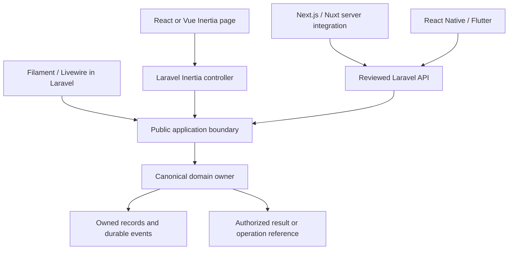

# Presentation layers, packages and shared contracts

Choose a presentation by its application boundary and audience, then enable only the modules needed for that surface. A framework name does not establish package availability: the [source inventory](SOURCE-INVENTORY.md), project source maps and [implementation references](../modules/source/README.md) identify observed code. Module plans describe the target where an adapter is not implemented.

## Choose the delivery boundary

| Layer | Application responsibility | Reusable module responsibility | Package/release tool |
| --- | --- | --- | --- |
| Core | Select compatible modules and deployment context | Domain rules, public actions/queries, owned persistence and events | Composer for PHP packages |
| API | Select route groups, audiences, credentials and contract versions | Authorized DTOs/commands over the public owner boundary | Composer for PHP API adapters |
| Filament | Configure panels, tenancy and plugin composition | Resources, custom actions, pages/widgets and permitted owner queries | Composer; JavaScript assets need npm packaging only if separately published |
| Livewire | Host routes, sessions, component registration and assets | Components/views, safe presentation state and explicit action calls | Composer; application asset builds use their declared JS toolchain |
| React + Inertia | Laravel routes/controllers, Inertia props/redirects and Vite/SSR configuration | Reusable React UI and a separate Inertia transport/navigation wrapper | npm for independent JS libraries; Composer where a PHP bridge/package is actually provided |
| Vue + Inertia | Equivalent Laravel/Inertia host boundary | Vue primitives/composables plus the Inertia wrapper | npm for independent JS libraries; Composer for any PHP bridge |
| Next.js | Application routing, session integration, server/client boundaries and deployment | Components, typed API integration and explicit server/client exports | npm for libraries; keep the application root private |
| Nuxt | Application routing, session integration, SSR/runtime configuration and deployment | Vue components/composables and deliberate API/server integration | npm for libraries; keep the application root private |
| React Native | Device navigation, secure session storage, platform permissions and app release | Focused screens, typed API adapters and explicit offline/conflict behavior | npm for JS libraries; device app release is separate |
| Flutter | Device navigation, secure storage, platform configuration and app release | Dart DTOs/widgets/services over the reviewed API | Dart/pub metadata and its intended distribution; not npm merely because Flutter also targets web |

A PHP adapter can contain JS assets without being an npm library. Conversely, a Next.js UI package does not become a Composer package because it consumes Laravel. Use the real `composer.json`, `package.json` or `pubspec.yaml`; repository slugs and design identifiers are not installation evidence.

## Requests and authoritative behavior



The public boundary can be called directly within a trusted Laravel host. An independently deployed client uses a reviewed API. Both paths preserve owner policy, tenant context, validation, state transitions and recovery. Neither UI visibility nor authentication alone is the complete authorization decision.

Inertia has its own page/redirect protocol. An Inertia visit cannot consume a bare REST JSON resource as if it were a page. A Laravel controller can call a public use case and return an Inertia response, while an independent API controller serializes the approved HTTP DTO. This shares behavior without imposing unnecessary loopback HTTP inside the same application. See [Inertia lifecycle](https://inertiajs.com/docs/v3/core-concepts/how-it-works), [redirects](https://inertiajs.com/docs/v3/the-basics/redirects), and the [Inertia standard](../standards/INERTIA.md).

## What React and Inertia can share with Next.js

Share framework-independent components, semantic design tokens, formatting, field primitives and schema-derived DTOs. Keep framework navigation/session imports and transport lifecycle in adapters. A component that imports `@inertiajs/react` is not automatically a reusable Next.js primitive; isolate the dependency before sharing it.

| Shared contract | Inertia wrapper | Next.js wrapper |
| --- | --- | --- |
| Authorized serializable view data | Page props from Laravel | Server/API integration result |
| UI primitives and semantic tokens | Compose inside the Inertia page/layout | Compose inside application-owned layouts/components |
| User command intent | Inertia form/visit to a Laravel-owned route | Reviewed server action/route handler or browser API transport |
| Validation and conflict outcomes | Map server errors/redirect lifecycle to the form | Map API/action outcome to field/review state |
| Successful or pending result | Refresh props or show the authorized operation | Invalidate/refetch the correct scoped reads or show the operation |

Next.js Server Components can load data and compose interactive Client Components. Pass appropriate serializable data across that boundary; ordinary event callbacks belong inside a client boundary unless using the framework's documented server-action mechanism. Keep credentials and secret-bearing helpers in server-only exports. See [Next.js server/client boundaries](https://nextjs.org/docs/app/getting-started/server-and-client-components) and the [Next.js standard](../standards/NEXTJS.md).

A proposed common UI result type might distinguish the following outcomes:

```ts
export type CommandOutcome =
  | { kind: 'completed'; subjectReference: string; businessState: string }
  | { kind: 'accepted'; operationReference: string }
  | { kind: 'invalid'; fieldErrors: Record<string, string[]> }
  | { kind: 'conflict'; reviewReference?: string };
```

This is an illustrative UI contract, not a claim about existing API response fields. Generate/map DTOs from the actual reviewed API. In particular, an accepted operation is not a completed business transition.

## Reuse without competing owners

Reuse one canonical domain owner and an explicit adapter home where compatibility is established. The [Next.js registry](../modules/nextjs/OWNERSHIP.md) maps 1,392 documented spellings to 617 plan groups and preserves source-identity naming collisions for review. Other layers should follow the same ownership principle rather than publishing a new implementation for every alternate design spelling.

An enterprise workspace can compose many existing product adapters. Accounting retains postings, Billing retains recurring commercial records, CRM retains relationship workflows, and physical operational owners retain their records. The workspace owns only its orchestration and authorized read model. See [shared ownership](SHARED-MODULES.md) and the [enterprise composition design](../projects/sap/COMPOSITION.md).

Repeated package identities or matching source files are not enough to claim safe adoption. Review source variants, public contracts, migrations, actor/tenant semantics and actual consumer tests before selecting a common release. Keep consumer policy in documented extension points instead of forking shared records or replacing an installed package silently.

## State and operational behavior across surfaces

Every enabled surface needs clear loading, empty, denied, invalid, stale/conflicting, pending and recoverable-failure states appropriate to its workflow. Preserve safe drafts, show the active entity and authoritative source reference, and offer a defined next action. Protected data must be removed at its server/API boundary, not merely hidden by CSS.

Use record versions and command identities only where the owner actually implements them. After an uncertain write, query the current operation/subject before retrying. Shared operation state, business state and source acknowledgements are separate; display their distinction. Bulk actions preserve per-record outcomes, and downloads recheck access. The [enterprise operation design](../projects/sap/design/OPERATIONS.md) supplies a concrete cross-layer example of these shared mechanics.

Mobile offline capture needs an explicit data and conflict policy. A local draft does not confirm an approval, posting, access change or custody transition. Revalidate authorization and state before replay; protect/expire cached evidence and clear it according to logout/revocation policy.

## Build, upgrade and verify

Install an existing clone from its selected lockfiles. A deliberately changed library needs a package build and a packed/clean-consumer check, not only a workspace link. Review React/framework peer versions, exported server/client boundaries, styles/assets and supported API contracts before publishing. Use the [Composer lifecycle](../guides/COMPOSER.md), [npm lifecycle](../guides/NPM.md), and each project's `DEVELOPMENT.md`.

Deploy compatible owner/API changes before dependent clients, retain the documented compatibility window and follow the host migration/worker/cache procedure. Test meaningful journeys in every enabled layer: allowed/denied/wrong-tenant operations, field errors, concurrency/retries, session expiry, cache isolation, asynchronous outcomes, downloads and accessible interaction. Record actual results and limitations rather than deriving parity from package names or copied templates.
