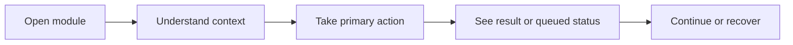

# Accounting Accounting Payroll Liabilities — end-user guide

**Project:** [Accounting](../README.md)
**Feature specification:** [accounting-payroll-liabilities.md](../../../../projects/accounting/features/accounting-payroll-liabilities.md)
**Shared experience standard:** [Web and mobile](../../../WEB-AND-MOBILE.md)

<!-- module-scope:start -->
**Availability:** this is a task/experience contract. Confirm the enabled application and your permitted actions; a documented capability or source package does not prove that every screen is deployed.

## Module-specific scope

The intended **Payroll Liabilities** workspace covers agency/payee balances, due dates, payments, allocations, exceptions, and reconciliation.

The relevant capability areas are **Agency/payee balances**, **Due dates**, **Payments**, **Allocations**, **Exceptions**, **Reconciliation**. Use their actual enabled screens/operations rather than treating every area as an interchangeable create/edit/delete resource.

## Follow the task safely

1. Open the enabled module from the appropriate project workspace and confirm the current account/team and any relevant entity, store, site or record scope.
2. Review the selected record/context, current state, source evidence and available actions. A visible action can still be restricted by record policy, approval, version or effective date.
3. Enter the required information using the actual form labels and authorized choices. Review any preview/approval summary and submit the explicit action; a generic status edit is not a substitute for a business transition.
4. Read the result. Queued/running means work continues; confirm a final business outcome only when the owner reports it. Keep an operation/reference link for long-running or uncertain work.
5. Correct field errors with the safe draft preserved. Reload/review a changed record before resubmitting; after a timeout, inspect the existing operation/current record before repeating a write.

Different modules have different valid commands, permissions and correction rules. Posted, accepted, published or otherwise finalized records may require a dedicated correction/reversal process rather than ordinary deletion. The owning module contract determines the actual behavior.

## Administrator and developer references

The [source map](../../../../projects/accounting/SOURCE-MAPPING.md#accounting-payroll-liabilities) distinguishes target requirements, source identities and layer availability. It does not certify runtime parity.

Observed implementation references: [liberusoftware/module-accounting-payroll-liabilities](../../../../modules/source/liberusoftware--module-accounting-payroll-liabilities.md). These technical references identify current metadata/code, not a promise that every target journey is enabled.

Presentation/transport detail: [API plan](../../../../projects/accounting/api/accounting-payroll-liabilities.md) · [Next.js plan and shared adapter home](../../../../projects/accounting/nextjs/accounting-payroll-liabilities.md). Inertia and independent API clients can share domain/UI contracts while keeping their navigation, session and form lifecycles separate.

This spelling/consumer maps to the same observed core identity as [Payroll Liabilities](payroll-liabilities.md). Its local scope remains preserved; avoid creating a competing record owner or assuming every consumer has identical deployed UI.
<!-- module-scope:end -->

## What users see

See the Accounting Payroll Liabilities context first, then the next safe action. The module should explain its purpose in the page heading, keep related evidence close to the decision, and never require users to understand internal package names.

## Primary journey

## Web behavior

Use a responsive page with a clear title, status/freshness, primary action, related context, and helpful empty/error states. Deep links should reopen the same safe context. Forms preserve entered data after validation errors; destructive or externally visible actions explain their impact before confirmation.

## Mobile behavior

Prioritize the frequent task and essential context. Keep the primary action reachable, use readable cards instead of dense tables, expose sync freshness, preserve drafts, and handle offline, interrupted, denied, and conflict states without claiming success prematurely. Notifications and deep links must respect permission and privacy.

## Visible states

- **Empty:** explain what is missing and the next useful setup or discovery step.
- **Success:** confirm what changed, when, and what the user can do next.
- **Queued:** show that processing continues, who owns it, and where progress appears.
- **Failure/conflict:** explain the problem in plain language and provide retry, review, or support recovery.
- **Denied:** explain the safe reason and an appropriate request/access path.

## Developer expectation

An installed surface is ready when this journey is represented in the relevant web/mobile navigation, authorization is enforced by the server, API errors map to accessible UI, loading and interruption are tested, and the module's terminology is consistent across web, mobile, email, and notifications.
