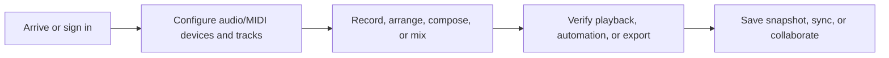

# Liberu Music DAW — end-user guide

**Experience area:** Digital audio workstation, recording, composition, mixing, mastering, and live performance
**Canonical developer scope:** [MUSIC.md](../../../projects/music/MUSIC.md)
**All module journeys:** [Module guides](modules/README.md)

## What users should feel

Musicians, producers, engineers, and collaborators see low-latency transport, clear device and routing state, non-destructive editing, reproducible sessions, and explicit separation between local audio runtime operations and cloud synchronization.

## Primary journey

## Web experience

The web surface supports project management, arrangement review, preset/media browsing, score review, collaboration comments, and supported WebAudio/WebMIDI sketching workflows, with explicit capability indicators when a workflow requires a native desktop or mobile audio host.

## Mobile and desktop experience

Desktop (`-dart-desktop`) provides full native audio graph execution, plugin hosting, multi-channel device routing, keyboard-driven editing, and offline stem/master rendering. Mobile (`-mobile-flutter`, `-dart-mobile`, `-mobile-react`) focuses on low-latency idea capture, clip launching, remote transport control, mix review, and resilient offline-to-cloud session synchronization.

## Visual acceptance

Use the shared [responsive shell and state contract](../../WEB-AND-MOBILE.md). A user must always be able to distinguish sample-accurate local audio state from asynchronous server/cloud synchronization state.

## Module map

See [all Music DAW module experiences](modules/README.md).

## Availability and implementation

These are target experience/task guides. Use the [current source map](../../../projects/music/SOURCE-MAPPING.md) to identify observed packages and source locations; confirm enabled UI and permissions in the installed application. Business state and operation progress remain separate across every presentation.
