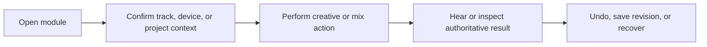

# Recording and Take Comping — end-user guide

**Project:** [Liberu Music DAW](../README.md)
**Feature specification:** [recording.md](../../../../projects/music/features/recording.md)
**Shared experience standard:** [Web and mobile](../../../WEB-AND-MOBILE.md)

<!-- module-scope:start -->
**Availability:** this is a task/experience contract. Confirm the enabled application and your permitted actions; a documented capability or source package does not prove that every screen is deployed.

## Module-specific scope

The intended **Recording and Take Comping** workspace covers track arming, count-in, punch and loop recording, take lanes, comp segments and recoverable disk writes. It is the authoritative domain boundary for this capability across web, mobile, and desktop DAW surfaces.

The relevant capability areas are **Track arming**, **Count-in**, **Punch**, **Loop recording**, **Take lanes**, **Comp segments**, **Recoverable disk writes**. Use their actual enabled screens/operations rather than treating every area as an interchangeable create/edit/delete resource.

## Follow the task safely

1. Open the enabled module from the appropriate project workspace and confirm the current account/team and any relevant entity, store, site or record scope.
2. Review the selected record/context, current state, source evidence and available actions. A visible action can still be restricted by record policy, approval, version or effective date.
3. Enter the required information using the actual form labels and authorized choices. Review any preview/approval summary and submit the explicit action; a generic status edit is not a substitute for a business transition.
4. Read the result. Queued/running means work continues; confirm a final business outcome only when the owner reports it. Keep an operation/reference link for long-running or uncertain work.
5. Correct field errors with the safe draft preserved. Reload/review a changed record before resubmitting; after a timeout, inspect the existing operation/current record before repeating a write.

Different modules have different valid commands, permissions and correction rules. Posted, accepted, published or otherwise finalized records may require a dedicated correction/reversal process rather than ordinary deletion. The owning module contract determines the actual behavior.

## Administrator and developer references

The [source map](../../../../projects/music/SOURCE-MAPPING.md#recording) distinguishes target requirements, source identities and layer availability. It does not certify runtime parity.

Presentation/transport detail: [API plan](../../../../projects/music/api/recording.md) · [Next.js plan and shared adapter home](../../../../projects/music/nextjs/recording.md). Inertia and independent API clients can share domain/UI contracts while keeping their navigation, session and form lifecycles separate.
<!-- module-scope:end -->

## What users see

See clear session context, active audio/MIDI routing, one primary creative or engineering action, real-time or queued status, and a non-destructive recovery path.

## Primary journey

## Web behavior

Provide responsive controls, keyboard shortcuts, accessible meter/timeline descriptions, and explicit capability notices when native low-latency audio or plugin hosting is required.

## Mobile and desktop behavior

Desktop hosts support full keyboard/windowed workflows and native audio/plugin execution. Mobile hosts prioritize capture, clip/scene triggering, remote control, and safe offline draft persistence before syncing revisions.

## Visible states

- **Empty:** explain how to add tracks, clips, devices, presets, or collaborators.
- **Success:** confirm the saved revision, playback state, or completed render/export.
- **Queued:** show render, stem export, or cloud sync progress with cancellation and retry controls.
- **Failure/conflict:** preserve local takes and edit history while offering revision comparison or device recovery.
- **Denied:** explain workspace permission or device-access requirements clearly.

## Developer expectation

An installed surface is ready when this journey is represented in the relevant desktop, mobile, and web hosts, authorization and revision checks are enforced by the server, audio callbacks remain lock-free, and terminology is consistent across all surfaces.
